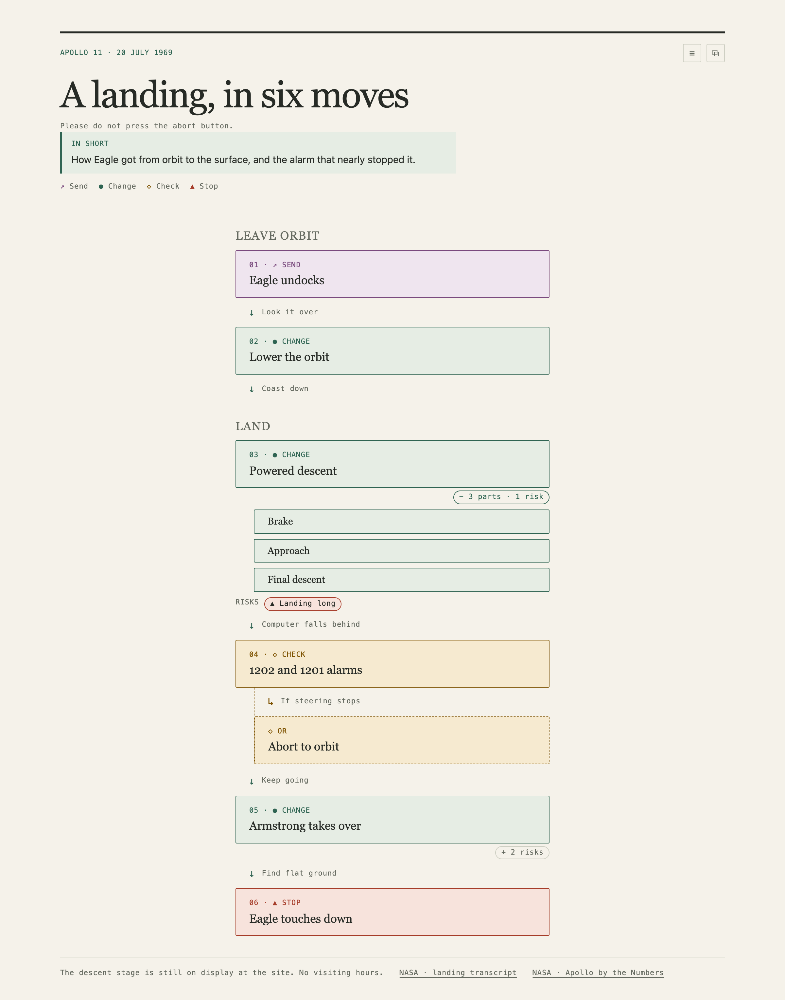
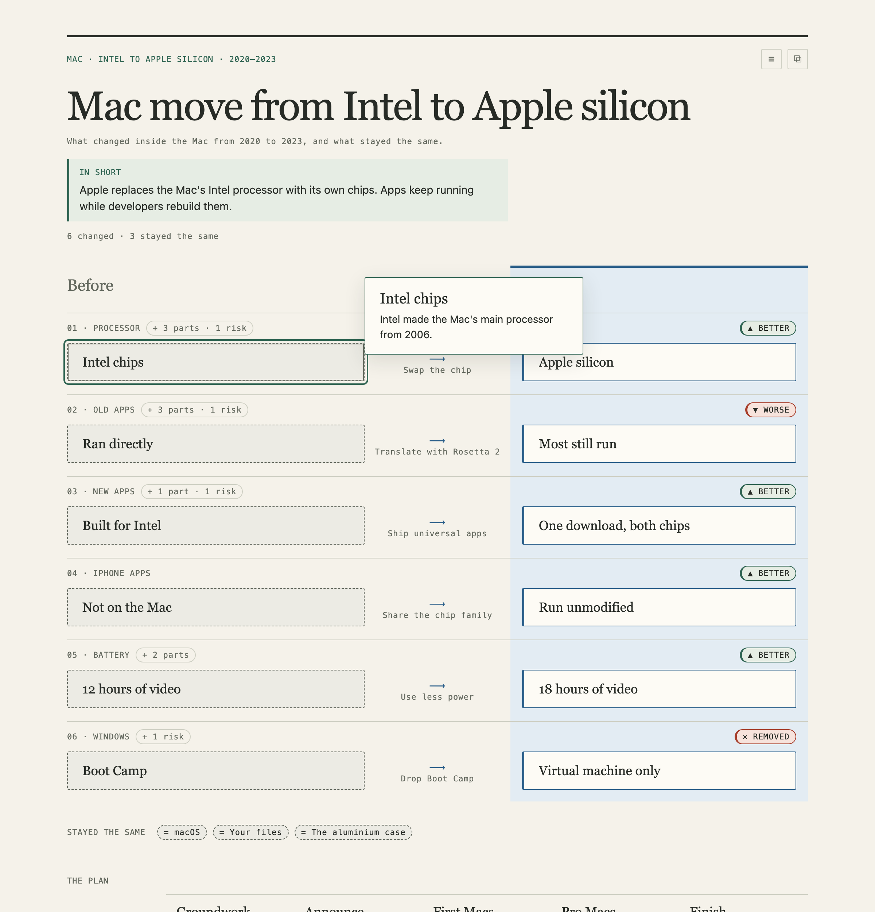
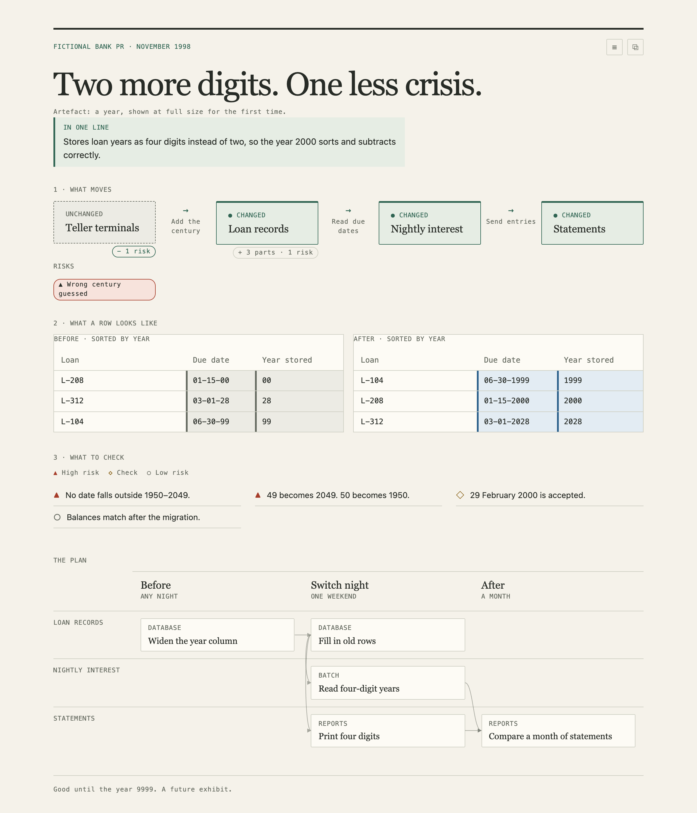
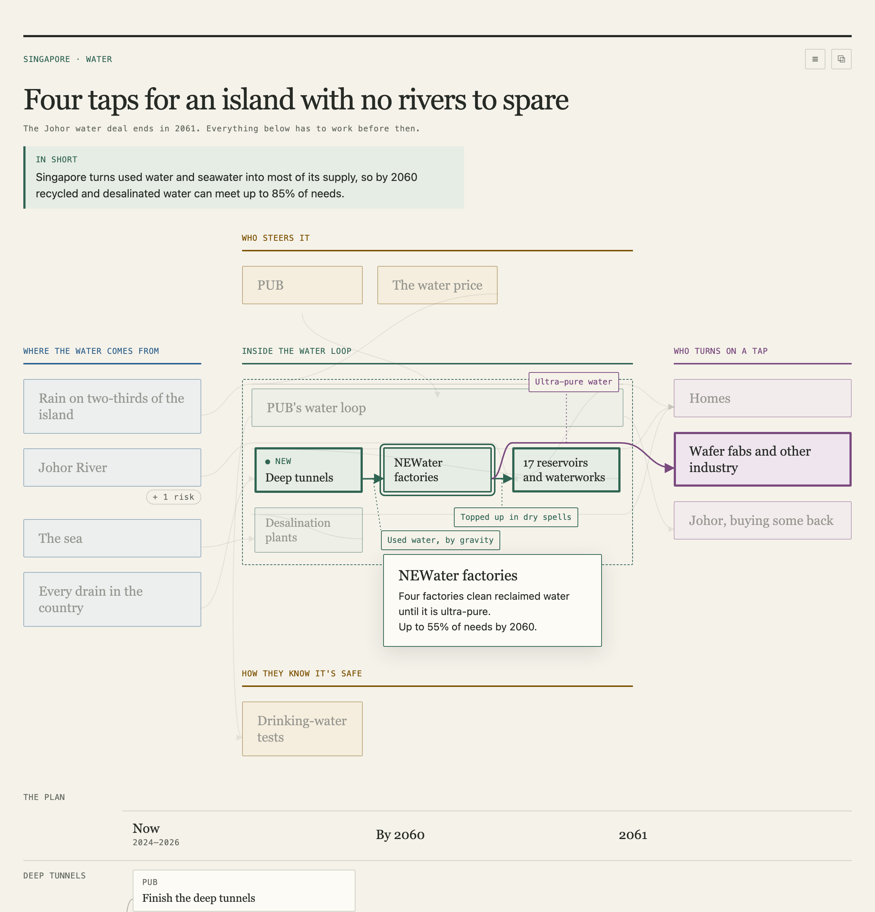
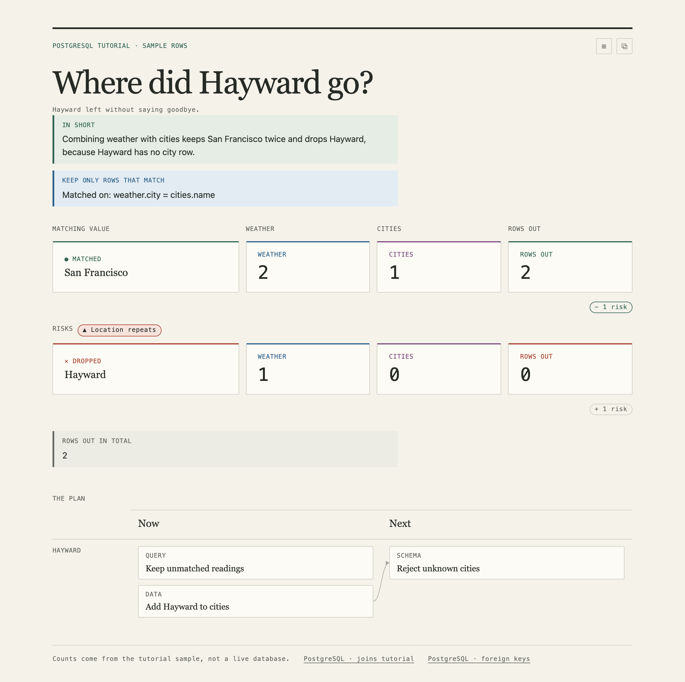
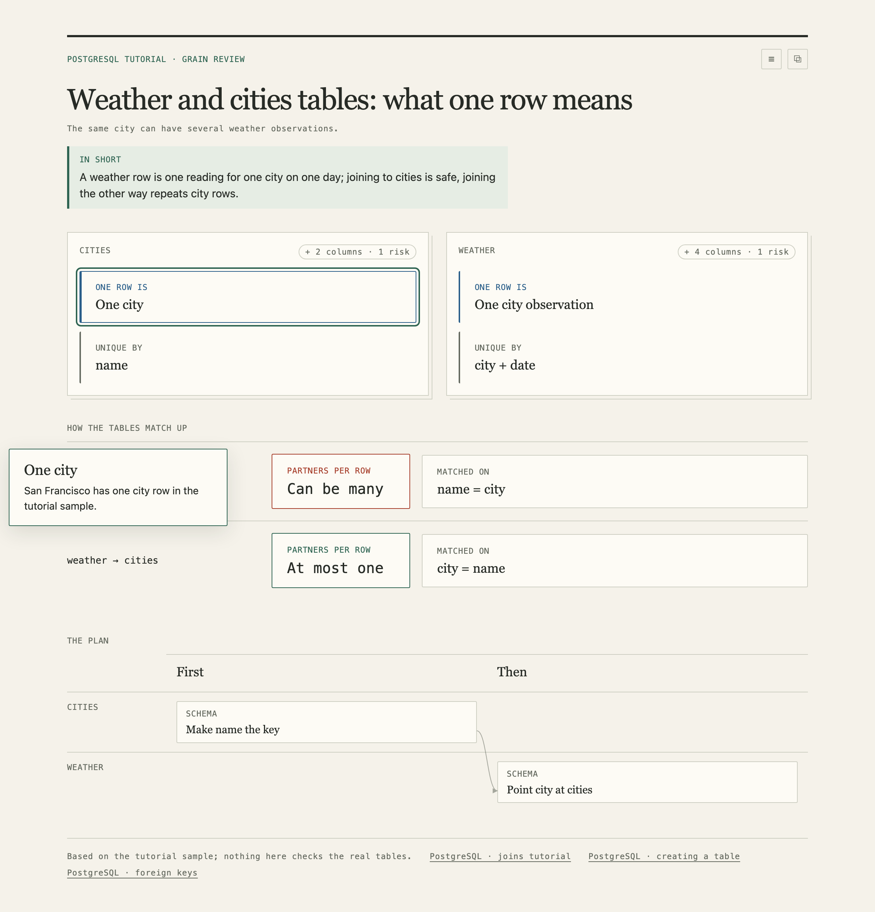

# diagram-kit

Explainer diagrams for any coding agent that stay quiet until you ask. At rest you see short labels; hover or tap a box or arrow for the plain-language detail.

Each skill copies one self-contained HTML template and fills only its JSON block, so even a small model with no tools produces a tidy diagram. Colours, layout and popover placement live in the template; broken or partial JSON still renders or says what to fix.

| Skill | Use it for | Example inside |
|---|---|---|
| [`flow-diagram`](skills/flow-diagram) | What some code does, step by step | Apollo 11 landing, 1969 |
| [`before-after`](skills/before-after) | What a big epic or migration changed | Mac moves from Intel to Apple silicon, 2020 |
| [`pr-explainer`](skills/pr-explainer) | Someone else's data-heavy PR | A 1998 bank's Y2K fix |
| [`system-plan`](skills/system-plan) | What feeds a system, what's inside, who it serves, plus the plan | Singapore's four water taps |
| [`join-explainer`](skills/join-explainer) | Why a join gained, lost or repeated rows | PostgreSQL tutorial: where did Hayward go? |
| [`grain-map`](skills/grain-map) | What one row means, and whether combining tables doubles counts | PostgreSQL tutorial: a city is not an observation |

## Install

Each skill is a folder with a `SKILL.md` and a standalone `template.html`, with no build step and no network calls. Copy the folders in `skills/` to wherever your agent reads skills:

| Agent | Folder |
|---|---|
| opencode | `~/.config/opencode/skills/` |
| Claude Code | `~/.claude/skills/` |
| Others | `.agents/skills/`, or point the agent at a `SKILL.md` |

```
git clone https://github.com/DullyLabs/diagram-kit && cp -r diagram-kit/skills/* ~/.config/opencode/skills/
```

Then ask: "explain this PR as a diagram". Each skill's folder has a screenshot and a filled-in `example.html` (live at `https://dullylabs.com/diagram-kit/skills/<name>/example.html` once Pages is on).








To change a template, edit `src/` and run `python3 src/build.py`; checks are in `test/`.

MIT licence. Please do not press the exhibits. Actually, do: that's how they work.
