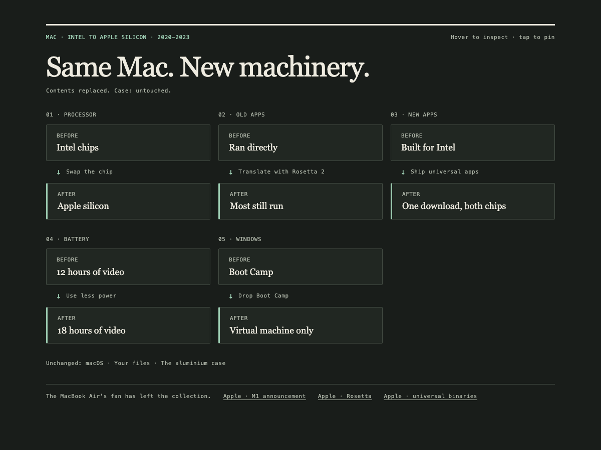
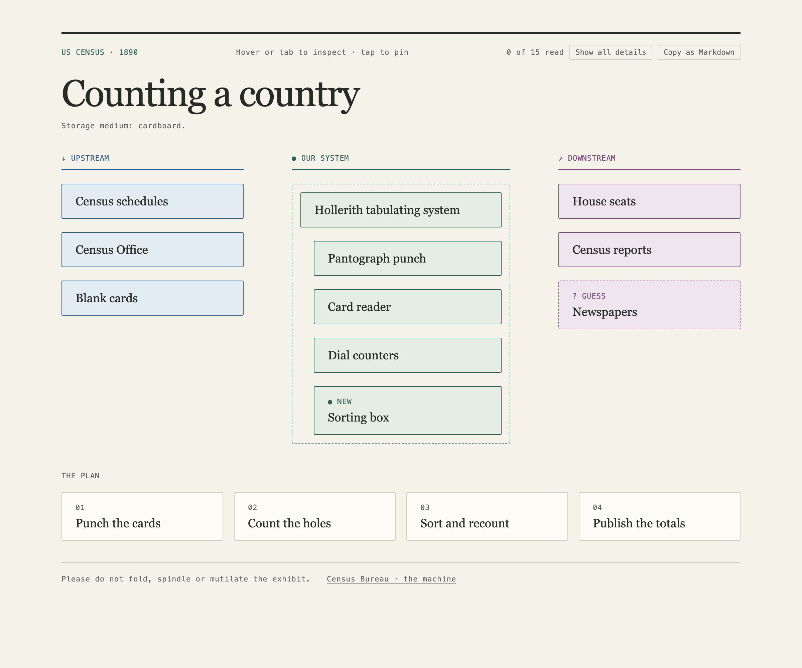

# diagram-kit

Explainer diagrams for any coding agent that stay quiet until you ask. At rest you see short labels; hover or tap a box or arrow for the plain-language detail.

Each skill copies one self-contained HTML template and fills only its JSON block, so even a small model produces a tidy diagram.

| Skill | Use it for | Example inside |
|---|---|---|
| `flow-diagram` | What some code does, step by step | Apollo 11 landing, 1969 |
| `before-after` | What a big epic or migration changed | Mac moves from Intel to Apple silicon, 2020 |
| `pr-explainer` | Someone else's data-heavy PR | A 1998 bank's Y2K fix |
| `system-plan` | Upstream → your system → downstream, plus the plan | 1890 US Census tabulator |

## Install

Each skill is a folder with a `SKILL.md` and a standalone `template.html`, with no build step and no network calls. Copy the folders in `skills/` to wherever your agent reads skills:

| Agent | Folder |
|---|---|
| opencode | `~/.config/opencode/skills/` |
| Claude Code | `~/.claude/skills/` |
| Others | `.agents/skills/`, or point the agent at a `SKILL.md` |

```
git clone https://github.com/DullyLabs/diagram-kit && cp -r diagram-kit/skills/* ~/.config/opencode/skills/
```

Then ask: "explain this PR as a diagram".






MIT licence. Please do not press the exhibits. Actually, do: that's how they work.
