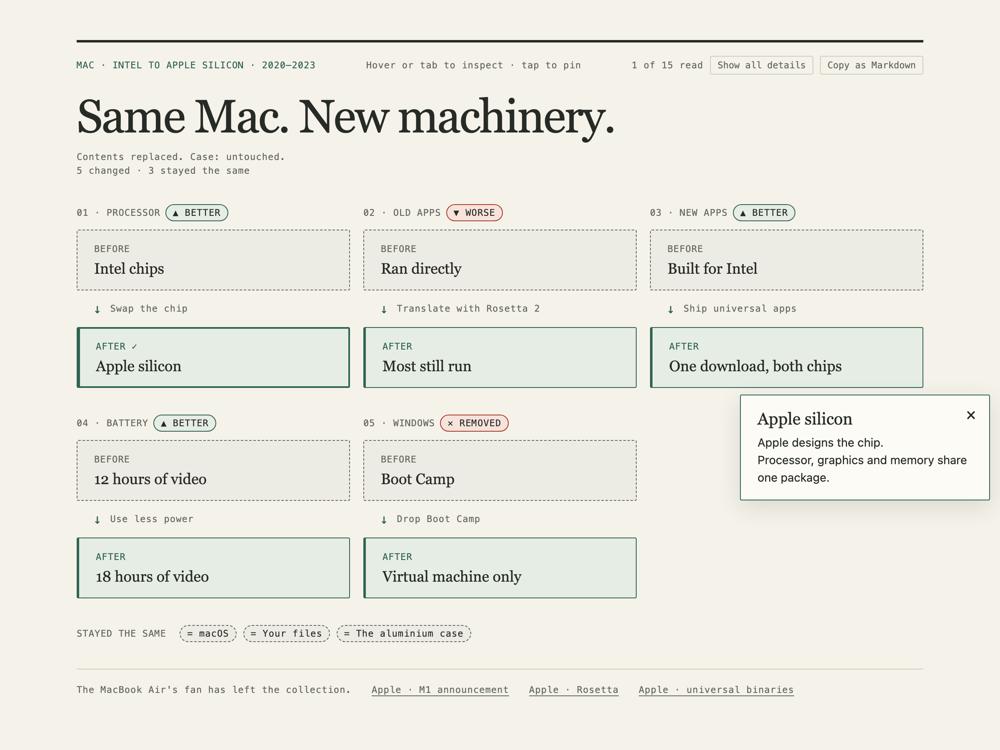

# before-after

**Use it when** asked what a big change (an epic, migration, rewrite or long branch) changed, or for a before/after comparison.

**[Open the live example](https://dullylabs.com/diagram-kit/skills/before-after/example.html)**: hover or tap any box or arrow.

The model copies `template.html` and fills its JSON block as [SKILL.md](SKILL.md) shows; `example.html` is that template filled in.
