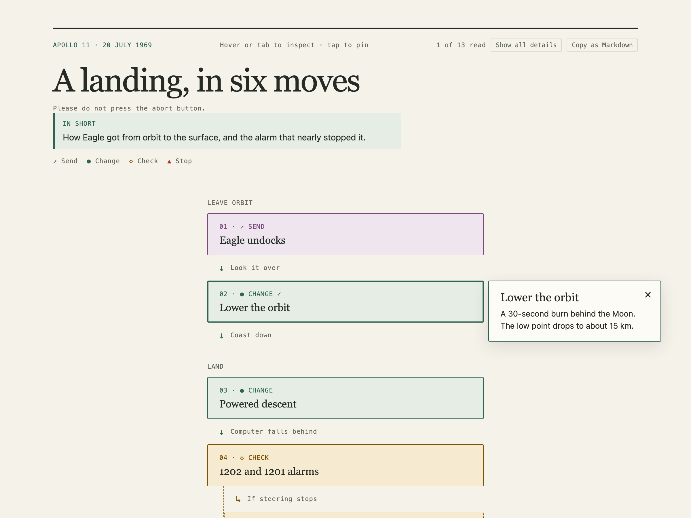

# flow-diagram

**Use it when** asked to explain how some code, job or process works step by step, or for a flowchart or flow diagram.

**[Open the live example](https://dullylabs.com/diagram-kit/skills/flow-diagram/example.html)**: hover or tap any box or arrow.

The model copies `template.html` and fills its JSON block as [SKILL.md](SKILL.md) shows; `example.html` is that template filled in.
