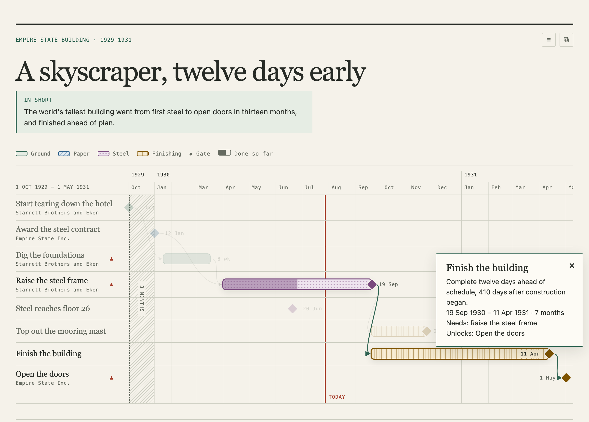

# gantt-chart

**Use it when** asked for a Gantt chart, a schedule, a timeline or a roadmap, or when the work is a list of tasks with dates.

**[Open the live example](https://dullylabs.com/diagram-kit/skills/gantt-chart/example.html)**

The model copies `template.html` and fills its JSON block as [SKILL.md](SKILL.md) shows; `example.html` is that template filled in.
