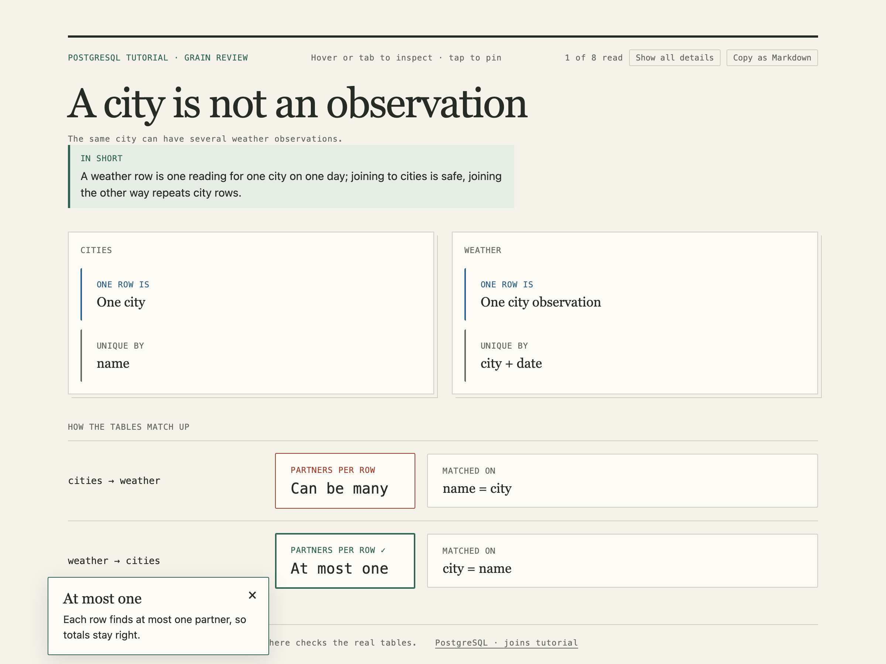

# grain-map

**Use it when** asked what one row of a table means, whether combining tables will repeat or double-count rows, or for a grain or cardinality check.

**[Open the live example](https://dullylabs.com/diagram-kit/skills/grain-map/example.html)**: hover or tap any box or arrow.

The model copies `template.html` and fills its JSON block as [SKILL.md](SKILL.md) shows; `example.html` is that template filled in.
