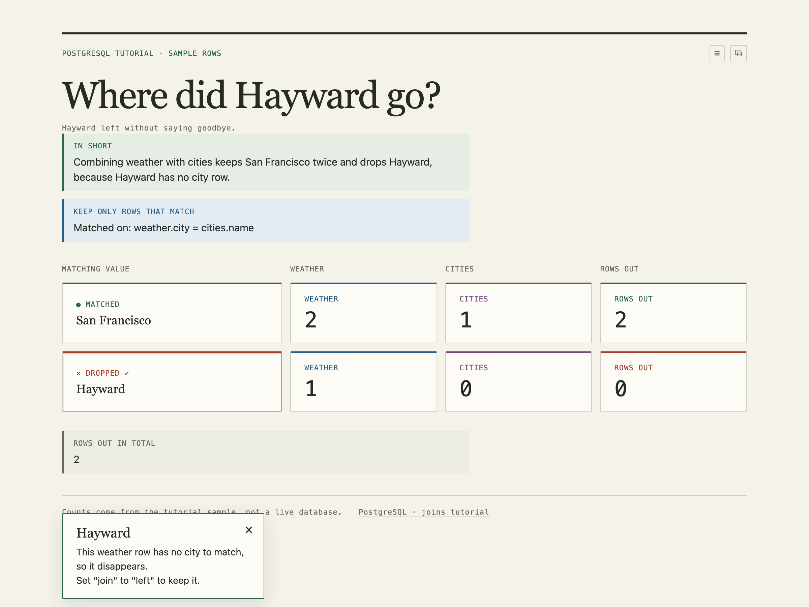

# join-explainer

**Use it when** asked why a join, merge or lookup gained, lost or repeated rows, or how two tables combine.

**[Open the live example](https://dullylabs.com/diagram-kit/skills/join-explainer/example.html)**

The model copies `template.html` and fills its JSON block as [SKILL.md](SKILL.md) shows; `example.html` is that template filled in.
