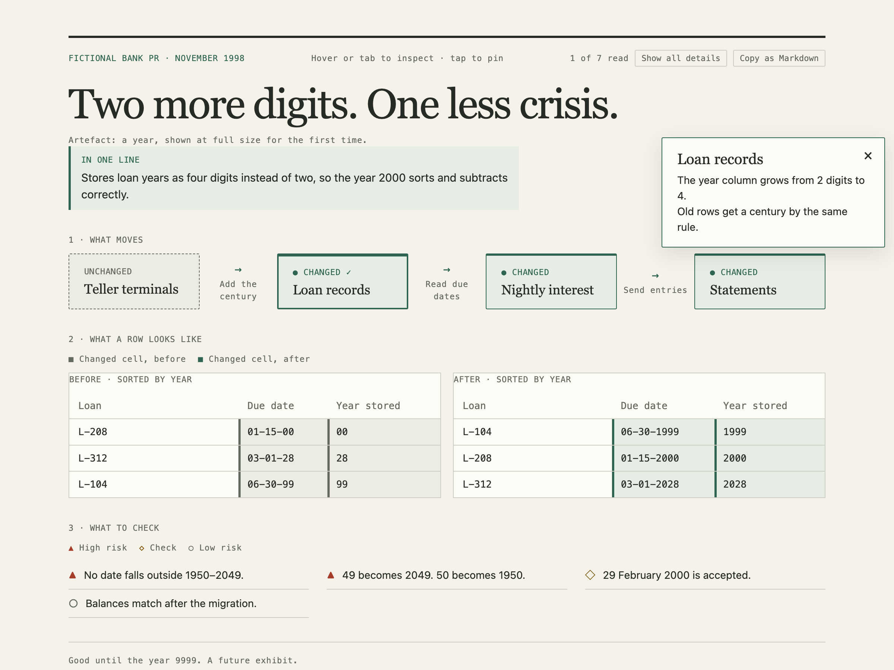

# pr-explainer

**Use it when** asked to explain someone else's pull request, especially one that changes SQL, tables or data pipelines.

**[Open the live example](https://dullylabs.com/diagram-kit/skills/pr-explainer/example.html)**: hover or tap any box or arrow.

The model copies `template.html` and fills its JSON block as [SKILL.md](SKILL.md) shows; `example.html` is that template filled in.
