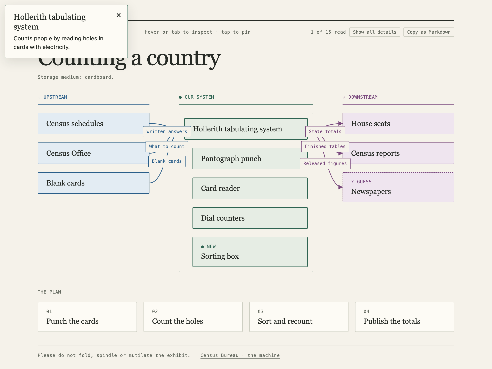

# system-plan

**Use it when** planning a large epic that reads from some systems, changes or builds one, and serves others, or when asked for a system context diagram.

**[Open the live example](https://dullylabs.com/diagram-kit/skills/system-plan/example.html)**: hover or tap any box or arrow.

The model copies `template.html` and fills its JSON block as [SKILL.md](SKILL.md) shows; `example.html` is that template filled in.
